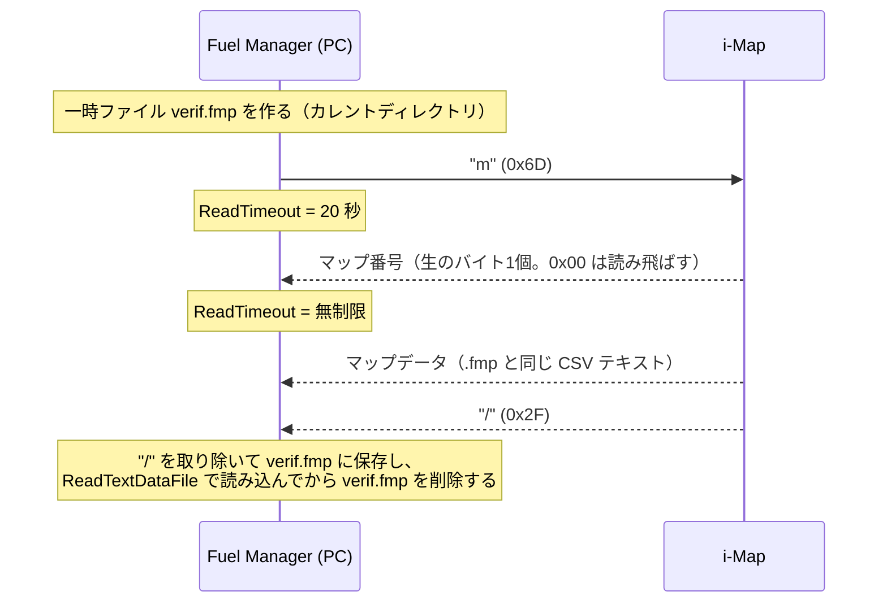
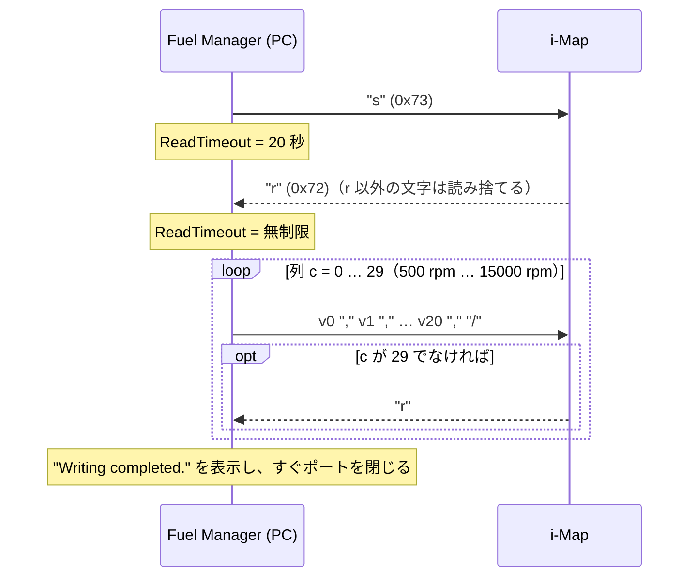

# 4. シリアル通信プロトコル

## 4.1 物理層と回線設定

| 項目 | 値 | 確度 |
|---|---|---|
| ケーブル | KITACO i-Map 専用 PC インターフェイスケーブル（763-0500900） | 【裏付け：取扱説明書】 |
| USB-シリアル変換 | Silicon Labs CP210x（デバイスマネージャ上の表示は「Silicon Labs CP210x USB to UART Bridge (COMn)」） | 【裏付け：同梱ドライバ、取扱説明書 14・36 ページ】 |
| 通信速度 | **38400 bps** | 【観測】`InitializeComponent` で `SerialPort1.BaudRate = 38400` |
| データビット / パリティ / ストップビット | 8 / なし / 1 | 【観測】設定していないので .NET `SerialPort` の既定値になる |
| フロー制御 | なし（`Handshake.None`）。DTR と RTS も既定値（無効） | 【観測】同上 |
| 文字コード | ASCII（`SerialPort.Encoding` の既定値） | 【観測】 |
| i-Map への電源 | 12V が必要。車体に付けたまま通信するならメインキーを ON にする | 【裏付け：取扱説明書 26 ページ】 |
| エンジン | **止めておく**。エンジンがかかると、i-Map はケーブルとの通信をしない | 【裏付け：取扱説明書 26 ページ】 |

### 文字コードについての注意

`SerialPort.ReadChar()` は受け取ったバイトを ASCII として解釈します。そのため、0x80 以上のバイトは `?`（0x3F）に置き換わります【観測：.NET の仕様】。本体からのマップ番号を正しく受け取れるのは、0x01〜0x7F の範囲だけです。

## 4.2 COM ポートの選び方

| 状態 | 動作 |
|---|---|
| 起動直後 | `PortName = "COM20"`。この値を「未設定」の意味で使っている |
| COM メニューで選んだとき | 選んだ項目の文字列（`COM1`〜`COM20`）を `PortName` に入れる |
| Read / Write を押したとき `PortName == "COM20"` なら | `Open_port()` で自動検出する |

自動検出（`Open_port`）の処理は次のとおりです【観測】。

```text
n = 20
while n > 2:
    "COMn" を開いてみる
      成功 → すぐ閉じて、PortName = "COMn" のまま終了
      失敗 → n = n - 1
n == 2 まで来た（COM20〜COM3 が全部失敗）→ "Communication device is not connected." を表示し、PortName = "COM20" に戻す
```

- 開けたかどうかだけで判断しています。**接続先が i-Map のケーブルかどうか（USB の VID/PID や応答）は確かめていません**。
- COM1 と COM2 は自動検出の対象外です。
- `"COM20"` が「未設定」を意味するため、ケーブルが本当に COM20 にあると使えません（[5 章](05-quirks-and-bugs.md)）。

## 4.3 コマンドと記号の一覧

PC ソフトが使っているのは次のものだけです。ほかにコマンドがあるかどうかは【不明】です。

| 向き | 文字 | バイト | 意味 | 確度 |
|---|---|---|---|---|
| PC → i-Map | `m` | 0x6D | マップを読み出す要求 | 【観測】 |
| PC → i-Map | `s` | 0x73 | マップを書き込む開始の要求 | 【観測】 |
| i-Map → PC | `r` | 0x72 | 受け取る準備ができた（ready） | 【観測】PC 側が待っている値 |
| i-Map → PC | （生のバイト） | 0x01〜0x7F | 読み出したマップの番号 | 【観測】【裏付け】 |
| 両方向 | `,` | 0x2C | 値の区切り | 【観測】 |
| 両方向 | `/` | 0x2F | 読み出し：データ全体の終わり。書き込み：1 列の終わり | 【観測】 |
| i-Map → PC | CR / LF | 0x0D / 0x0A | 読み出しデータの行区切り | 【推測】下記参照 |

## 4.4 読み出し (Read)

`Button1_Click` の処理です。取扱説明書によると、読み出されるのは**本体の DIP スイッチで選んでいるマップ**です。プリインストールのマップもユーザーオリジナルのマップも読み出せます【裏付け：取扱説明書 26 ページ】。



### 手順の詳細【観測】

1. `verif.fmp` という空のファイルを、カレントディレクトリに作ります（この処理は例外処理の外側にあります）。
2. ポートを開いて `"m"` を送ります。
3. `ReadTimeout = 20000`（20 秒）にして、`ReadChar()` が 0 以外の値を返すまでくり返します。最初に来た 0 以外の文字コードが**マップ番号**です。
4. `Label1` に `"map_no_" + 文字コードの10進表記` を表示します。
5. `ReadTimeout = -1`（無制限）にして、`Read(buf, 0, 4000)` で受け取ったものを ASCII として順につなげていきます。**つなげた文字列の最後の1文字が `/` になったら**受信を終えます。
6. 最後の `/` を取り除き、`WriteLine(データ)` と `WriteLine()` で `verif.fmp` に書き出してから、`ReadTextDataFile` で読み込みます（解析の規則は [3.4 節](03-map-data-and-fmp-format.md#読み込み処理readtextdatafileの動作)と同じです）。
7. 「Read completed.」を表示し、ポートを閉じて `verif.fmp` を削除します。
8. 例外が起きた場合は、どんな例外でも「Communication device is not connected.」を表示します。最初の応答が 20 秒来ないときの `TimeoutException` もこれに含まれます。ただし、受け取ったデータの解析エラーは `ReadTextDataFile` の中で処理されます。その場合はエラー表示のあとに「Read completed.」も表示されます（[5.6 節](05-quirks-and-bugs.md#56-読み出しのエラー表示がまぎらわしい)）。

### マップ番号は生のバイト値

ラベルに出るのは**受け取った文字そのものではなく、文字コードの10進表記**です。取扱説明書 27 ページの画面写真には `map_no_7` と表示されています。もし本体が ASCII の `'7'`（0x37）を送っていれば `map_no_55` になるはずです。したがって、**本体はマップ番号を 0x07 のような生のバイト値で送っている**と考えられます【裏付け】。

取扱説明書 26 ページによると、マップは本体の 4 ビットの DIP スイッチで選びます。マップ番号は DIP スイッチの状態に対応していると考えられますが、具体的な対応（どのスイッチの組み合わせが何番か、何番がユーザーオリジナルか）は【不明】です【推測】。

### 本体が送るデータの形についての推測

PC 側の実装から、本体の送信データは次の条件を満たしている必要があります【推測】。

- `/` は**最後のバイトとして**送られる。受信の終わりは「つなげた文字列の最後の1文字」でしか判定していないため、`/` のあとに改行などが続くと受信が終わりません。
- 行の区切りは CR、LF、CRLF のどれか（`TextFieldParser` はどれでも受け付けます）。
- 各行の末尾にカンマは付かない。付いていると解析エラーになります。書き込み時の形式（末尾に `,` が付く）とは違います。
- 30 行で、各行に生の値が 21 個ある（3.4 節の文法どおり）。

## 4.5 書き込み (Write)

`Button2_Click` の処理です。取扱説明書によると、書き込み先は **i-Map のユーザーオリジナルマップ領域**です【裏付け：取扱説明書 28 ページ】。



### 手順の詳細【観測】

1. ポートを開いて `"s"` を送ります。
2. `ReadTimeout = 20000` にして、`ReadChar()` が `114`（`'r'`）を返すまでくり返します。`r` 以外の文字は読み捨てます。
3. `ReadTimeout = -1`（無制限）にします。
4. 列 `c = 0..29` について次の処理をします。
   - 21 個の値を、それぞれ **10 進の文字列 + `,`** として送ります。値は `c <= rpm_cell` なら `表の値 + 100`、そうでなければ `0` です（[3.5 節](03-map-data-and-fmp-format.md#35-表の値と出力される値の関係)）。
   - 続けて `/` を送ります。つまり**最後の値のあとにもカンマが付きます**。
   - `c != 29` なら、`'r'` が来るまで待ちます（待ち時間の上限なし）。
5. 最後の列を送ったら応答を待たずに「Writing completed.」を表示し、ポートを閉じます。
6. 例外が起きた場合は、例外のメッセージを「Connection error」というタイトルで表示します。

### 送るバイト列の例

すべて補正なし（生の値 100）の列：

```text
100,100,100,100,100,100,100,100,100,100,100,100,100,100,100,100,100,100,100,100,100,/
```

リミットより上の列：

```text
0,0,0,0,0,0,0,0,0,0,0,0,0,0,0,0,0,0,0,0,0,/
```

- 1 列は 43 バイト（全部 `0` のとき）から 85 バイト（全部 3 桁のとき）です。
- 書き込み全体では、最大で `1 + 30 × 85 = 2,551` バイトです。38400 bps・8N1（約 3,840 バイト/秒）なら、送るだけで約 0.66 秒かかります。これに列ごとの応答待ちが加わります。
- 純正ソフトは、値やカンマを1つずつ `Write` で送っています。わざと間を空ける処理（`Sleep` など）はありません【観測】。

### 列ごとの応答の意味についての推測

PC は 1 列（最大 85 バイト）送るたびに `r` を待ちます。本体が列ごとに不揮発メモリ（EEPROM など）へ書き込んでいて、その完了を知らせるための受け渡しではないかと考えられます【推測】。最後の列のあとに本体が `r` を送るかどうか、また書き込みが本当に終わるまでどれくらいかかるかは【不明】です。純正ソフトは最後の列のあとすぐにポートを閉じていますが、本体への電源はケーブルとは別なので、ポートを閉じても本体の書き込みは中断されないと考えられます【推測】。

### 書き込みの検証

書き込んだあとに読み戻して比べる処理や、チェックサムによる確認は**ありません**【観測】。

## 4.6 タイムアウトのまとめ

| 段階 | 純正ソフトのタイムアウト |
|---|---|
| 読み出し：`m` に対する最初の応答（マップ番号） | 20 秒 |
| 読み出し：マップデータの受信 | 無制限 |
| 書き込み：`s` に対する `r` | 20 秒 |
| 書き込み：各列のあとの `r` | 無制限 |

無制限の段階で通信が途切れると、純正ソフトは応答しなくなります（[5 章](05-quirks-and-bugs.md)）。

## 4.7 わかっていないこと

| 項目 | 状態 |
|---|---|
| 本体が読み出しデータで使う改行コード | 【不明】PC 側はどれでも受け付ける |
| `/` のあとに本体が何か送るかどうか | 【推測】送らない（送ると純正ソフトは受信を終えられない） |
| 最後の列を書いたあと本体が `r` を返すか | 【不明】 |
| 列ごとの書き込みにかかる時間 | 【不明】 |
| `m` / `s` 以外のコマンド（エコー、バージョン取得など） | 【不明】 |
| 範囲外の値（例：141 や 59）を書き込んだときの本体の動作 | 【不明】 |
| リミットより上の領域で `0` 以外の値を書き込んだときの本体の動作 | 【不明】 |
| DIP スイッチでプリインストールマップを選んだまま書き込んだときの動作 | 【推測】取扱説明書によると、書き込み先はスイッチの位置にかかわらずユーザーオリジナル領域 |
| マップ番号と DIP スイッチの対応 | 【不明】 |
| ケーブルのピン配置と信号レベル | 【不明】（調査していない） |
